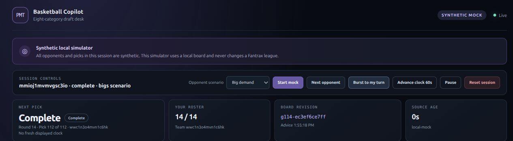

# Copilot implementation and validation — October 27, 2026

**Ready:** isolated local browser rehearsal and explicitly supplied pre-draft Coach observations. **Not ready:** automatic Fantrax live following, Fantrax queue/rank changes, or any Fantrax pick submission. The core model remains an experimental partial-coverage draft heuristic.

Built with Luna xhigh workers; integration/fixes/browser validation by the main orchestrator; [independent Sol medium source review](../../../../../docs/basketball/committee/12-sol-copilot-implementation-review.md). No remaining local-mode source blocker was found. The reviewer did not run tests or browser actions. [Runbook and remaining platform plan](../../../../../docs/basketball/copilot-runbook.md).

| Check | Actual evidence and scope |
|---|---|
| Build and compiled basketball tests | Successful build followed by **55/55 passing** basketball tests. [Log](compiled-tests.log). Covers eight-category scoring, summed shooting, active-ten optimization, profile adaptivity, off-turn scenarios, strict DOM scope, journal/corrections, poison/replay, duplicate races, expired clocks, blocked/stale Coach, and paused restart. No football suite or files changed for this task. |
| Browser rehearsal | **Three complete 112-pick drafts; 42 own picks; all eight teams legal at14 players/10active/4reserve.** Balanced/guard-demand/big-demand opponents. The latter two runs started Balanced for four selections, then explicitly pivoted. Browser actually clicked selectors/queue/confirmation; this was not direct API playback. [Original browser export](browser-export.json), [compact trace](browser-trace.json), [Balanced](mock-run-balanced.json), [Guards](mock-run-guards.json), [Bigs](mock-run-bigs.json). |
| Final client smoke | After source-age, response-order and timing-attribution fixes, two further own browser picks passed. An expired clock rejected the next confirmation with the board retained at21 picks; pause survived browser reload with confirm disabled. Reset to Balanced afterward. [Evidence](final-browser-smoke.json). The three full drafts preceded these final client-only fixes; the two-pick smoke is separate validation. |
| Engine latency | **100 saved simulated states on the real2,209-row forecast**, p50 **127.5ms**, p95 **159.1ms**, max **228.7ms**. Passes the500ms local calculation target. Original source instants preserved during replay; no refresh. [Samples](engine-benchmark.json). |
| Supported browser action/read latency | **153 actual CUA action→visible-result-wait→DOM-read intervals**: p50 **615ms**, p95 **900ms**, max **1,321ms**. Own confirmations n42: p95 **835ms**, max **864ms**. Excludes idle/model/orchestration delay between tool calls and does not measure external Fantrax detection. [Summary](latency-summary.json). |
| Client paint instrumentation | Earlier full runs had129 ordered matching click/API/render triples out of165 groups;36 incomplete/inconsistent groups excluded, so that filtered559ms p95 is not an all-actions metric. Fixed attribution so background polling cannot consume another action's render marker. Final smoke:16 valid triples/17 groups, p95/max488ms; rejected action has no success render. [Earlier raw events](browser-measurements.json), [final smoke events](final-client-measurements.json). |
| Observation volume / duration | 105 changing-pick browser observations (42own+63opponent bursts), plus reset/control observations. Rehearsal ran17:47:41–17:52:37UTC, **under five minutes**. The proposed sustained ten-minute, tool/orchestration-inclusive live bridge gate remains unpassed. |
| Actual Fantrax preflight | Re-read real authenticated room: Starting Wednesday October28,9PM EDT; jxstovik sixth;112empty cells. Fresh capture17:57:14.122UTC, local Coach receipt17:57:27.740UTC. **13.618s manual handoff**, one sample, not a p95 and not a three-second ingestion pass. [DOM fields](fantrax-preflight-fresh.json), [receipt](fantrax-coach-receipt.json). Coach source age uses capture time and keeps increasing. No live selected-player/clock parser proof. |
| Alternate Fantrax formats | NCAAB/NBA/All were empty earlier; All was rechecked17:54:58UTC and still displayed no draft games. No room joined, no paid venue/account/terms flow used. An open free NBA practice room could test transport with separate NBA identities; it cannot validate college strategy. |
| Saved-evidence doctor | [Doctor](saved-evidence-doctor.json) remains **partial**, `readyForPersonalAdvice:false`, `readyForExecution:false`. Running it did not fetch sources. This task refreshed only real draft-room/lobby reads; history, provider projections, rules, schedule and all-roster API evidence were not refreshed. The fresh draft capture is separate evidence, not a rewritten bundle timestamp. |
| Scheduling | Updated the same existing daily prompt to current implementation/source-refresh priorities. Its active state, recurrence, thread destination and expiry were verified unchanged. [Configuration verification](automation-update.json). No new scheduled firing observed in this build; no continuous watcher deployed. [Official scheduling reference](https://learn.chatgpt.com/docs/automations?surface=app). |

The real board remains revision `e3298d4ba837c70fabc3256b5856eb669c2da77ae06e31a62a814febbc71520b`,2,209forecasts/5,687identities,29targeted RotoWire rows,3cold starts and3,478named exclusions. Status blocks, unknown current roles/availability, schedule/weekly optimizer and lock/minimum/rounding gates remain. Shared scores are conditional per-game constructions, not category-win probabilities or evidence of an optimal draft strategy. Guard/Bigs preferences never change league scoring.

**Next deadline:** October28 at9PM EDT, rechecked in the actual room. Current history source reaches24hours atOctober28 04:00EDT; the current live-advice gate will suppress stale inputs. Tomorrow's source/role/status refresh must produce genuinely new observations and a new aligned board/session revision. Do not renew timestamps by replay. Then test complete live history, player identity, clock, correction provenance and the supported foreground bridge in a suitable free practice room. Keep native/manual drafting available. Every real writer remains absent.

