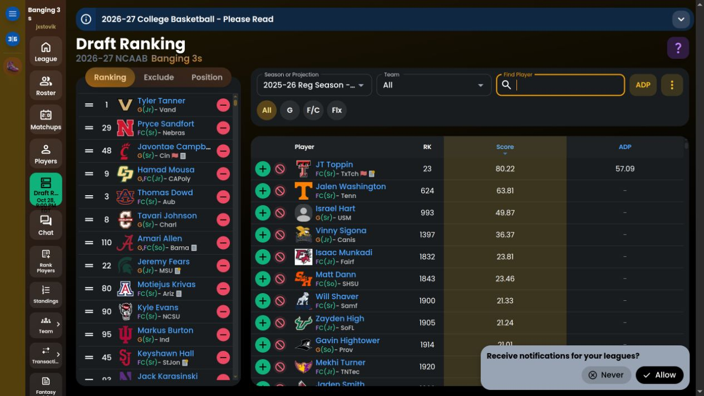

# Fantrax model rankings applied

User explicitly authorized setting the draft ranking list for jxstovik in Banging 3s. Uploaded the published Balanced draft-priority CSV once. Fantrax showed a connection failure; its normal reconnect UI recovered a persisted list of **2,196 players**. Complete rendered name/school readback confirms the model-relative order of every saved row. The initial Ranking/Exclude were empty and Position had no configured entries. No backup was overwritten.

**12 of 2,208 submitted rows did not appear.** Three are model ranks73 Skylar Wicks,100 Anquan Hill and103 Dashon Gittens. See [unmatched review](unmatched-review.csv) and [matching audit](matching-audit.json). No diagnostic remained after reconnect; do not invent an import-match reason or guess player IDs. The saved source has two Jalen Washington/Tennessee IDs, and a later direct Skylar Wicks search returned no visible result.

[Import manifest](import-manifest.json), [complete readback](import-readback.json), [receipt](applied-receipt.json), [original CSV](fantrax-model-rankings.csv), [before-state evidence](before-ui.json). JT Toppin was omitted from the imported list, but the Exclude list was not changed. Unmodeled identities were not assigned artificial ranks. Neither omission is a platform exclusion. The list is static model draft priority, not dynamic copilot ordering. The browser's left-side displayed RK numbers are Fantrax's metric; list order follows the model.

No source/model refresh, autopick-setting change, queue edit, position override, exclusion or pick was performed. This is a one-off authorized ranking import, not a deployed platform writer. Draft-day source/availability refresh remains required.

