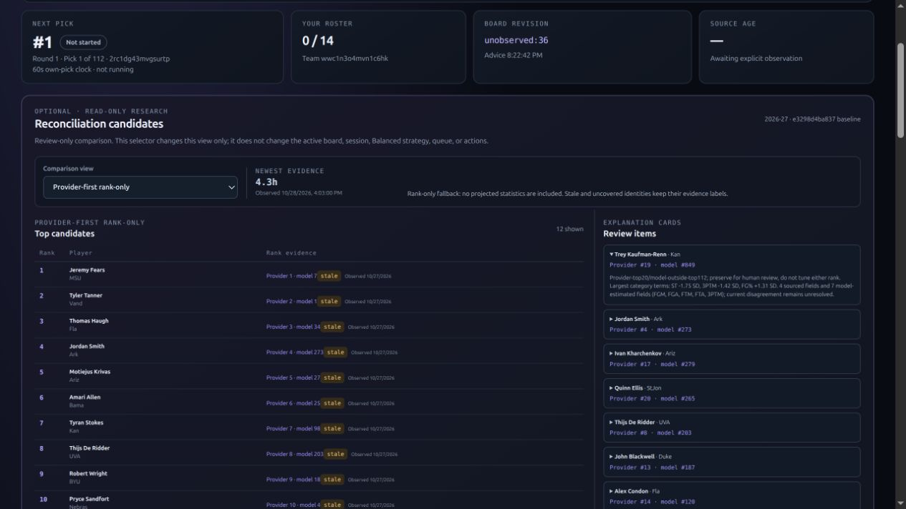

# Draft reconciliation delivered — October 28, 2026

Two separate review candidates are implemented: a corrected eight-category statistical board and a provider-first rank-only fallback. The original board reproduces exactly and remains active. No Fantrax ranking, queue, exclusion, autopick setting or pick changed during this reconciliation. The separately authorized October 27 list import remains separate.

[Open local comparison dashboard](http://127.0.0.1:46063/) · [corrected category board](revisions/344df1b91ab3126860cc43ec650a4b03835d9846cf16e067717d4f78a5d203f1/corrected-category-board.md) · [rank-only fallback](revisions/344df1b91ab3126860cc43ec650a4b03835d9846cf16e067717d4f78a5d203f1/provider-first-rank-only.csv) · [full diagnostics](revisions/344df1b91ab3126860cc43ec650a4b03835d9846cf16e067717d4f78a5d203f1/reconciliation.json) · [validation](validation.json) · [independent Sol medium review](../../../../docs/basketball/committee/13-sol-reconciliation-review.md)

The dashboard is an active local Coach process in this desktop session, with no explicit Fantrax observation ingested. Its research selector changes only the comparison panel. Its main advice still uses the original stale board and remains gated. This is not a deployed live observer or an automatic draft actor.

## What changed

The corrected board ranks equal standardized contributions across PTS, REB, AST, ST, BLK, 3PTM, FG% and FT%. It removes the old static 40th-player positional replacement subtraction; actual roster legality is checked separately. It incorporates current available-pool/position evidence and ten fresh public projection rows, including three additional provider-backed players. Source fields preserve their own timestamps. Missing FG/FT components and other unsupplied categories remain modeled.

There are **2,199 forecasts across 5,680 available identities**, including 32 with some provider projection fields. **3,481 identities remain without forecasts**; no synthetic values fill those gaps. There are 29 saved provider-ranked identities, all older than 24 hours at analysis time. The provider-first output keeps their observed order, then a clearly labeled model fallback tail; unmodeled review rows are excluded from proposed imports and rehearsals. It contains no projected statistics.

The two proposed native CSVs each contain 2,197 rows. They exclude the known JT Toppin status block and the ambiguous Jalen Washington name/school collision. They are **not uploaded** and are not a recommendation to activate either board automatically.

## How the rankings differ

All 20 saved provider top-20 players are modeled. **8 of 20 are outside the corrected model's top 112; 11 of 20 have an absolute rank gap above 40.** The browser's seven largest-gap cards are a display limit, not the total count. These differences remain unresolved; software correctness is not forecast accuracy.

| Player | Saved provider rank | Corrected category rank |
| --- | ---: | ---: |
| Jeremy Fears | 1 | 7 |
| Tyler Tanner | 2 | 1 |
| Thomas Haugh | 3 | 34 |
| Jordan Smith | 4 | 273 |
| Motiejus Krivas | 5 | 27 |
| Amari Allen | 6 | 25 |
| Tyran Stokes | 7 | 98 |
| Thijs De Ridder | 8 | 203 |
| Robert Wright | 9 | 18 |
| Pryce Sandfort | 10 | 4 |
| Nigel James | 11 | 20 |
| Tounde Yessoufou | 12 | 38 |
| John Blackwell | 13 | 187 |
| Alex Condon | 14 | 120 |
| Juke Harris | 15 | 115 |
| Nolan Winter | 16 | 58 |
| Ivan Kharchenkov | 17 | 279 |
| Flory Bidunga | 18 | 87 |
| Trey Kaufman-Renn | 19 | 849 |
| Quinn Ellis | 20 | 265 |

## What the sensitivity tests establish

- **Scoring format matters.** The league has eight category outcomes, including shooting percentages and no turnover penalty. A separate provider-described DraftKings core-points calculation uses PTS + 1.25×REB + 1.5×AST + 0.5×3PTM + 2×ST + 2×BLK − 0.5×TO. It compares exactly the same ten fresh players. Full DraftKings totals remain null because exact double/triple-double bonus definitions were not independently verified. This diagnostic does not reproduce the provider's expert ordering or attribute all gaps to scoring.
- **Percentage penalties do not explain every low big-man rank.** Kaufman-Renn is provider #19 versus category #849. His modeled ST contribution is −1.75 SD and threes −1.42 SD, while FG% helps at +1.31 SD. Removing FG% makes him #1,210; removing ST/BLK improves him to #525. Thus deleting percentage categories is not a general fix for this disagreement. These are fixed-population ablations, not alternate recommended league rules.
- **The shrinkage assumptions matter.** Real frozen-source replays at 0×/1×/2× prior strength move 170/179, 0/179 and 169/179 comparable priority-review category ranks respectively. Twelve additional union identities have no comparable frozen-source rank delta and remain unavailable. Kaufman-Renn changes #694 → #854 → #1,029 in that frozen context. This is descriptive sensitivity, not a confidence interval.
- **Reference population matters.** Full-pool renormalization changes 177 of the 184 reported review-cohort ranks. A separate 29-player overlap normalizes and ranks both methods on the same identities. Global ranks, overlap ranks and the 191-player review union are explicitly separated.
- **Position and minutes assumptions are visible.** No/32nd/40th/48th replacement cases and low/current/high minutes are computed. Neither is selected merely to increase agreement. Exact marginal FG/FT examples aggregate made/attempted totals for legal ten-active/four-reserve rosters.
- **Role and missing-stat evidence remain material.** Official school pages confirm several transfer/current-school identities but do not guarantee current minutes. Jordan Smith's suffix alias is documented; his cold start is not validated by replacing college rates with high-school numbers. Campbell/Evans historical defensive production can rank highly without a verified current role. Treat such leaders as research candidates until their roles are established.

The same-player core-points comparison is:

| Player | Core points rank among these ten | Eight-category rank among these ten |
| --- | ---: | ---: |
| Tyler Tanner | 1 | 1 |
| Robert Wright | 2 | 4 |
| Markus Burton | 3 | 3 |
| Pryce Sandfort | 4 | 2 |
| PJ Haggerty | 5 | 9 |
| Thomas Haugh | 6 | 6 |
| Josh Hubbard | 7 | 8 |
| Tounde Yessoufou | 8 | 7 |
| Juke Harris | 9 | 10 |
| Milan Momcilovic | 10 | 5 |

## Source refresh and limits

Actually acquired: official Fantrax Standard per-game CSV (observed 19:59:45 UTC), ten publicly displayed RotoWire projection rows (19:56:03 UTC), and selected current role/status pages. Official export has 19 removed/12 added IDs and 12 changed eligibility records; all 5,668 shared historical lines are unchanged. Absence does not establish a removal reason. Zero-GP history coverage and quarantined rows remain unresolved.

The 29 saved expert rank records keep their October 27 11:24:32 UTC observation; their timestamps were not renewed. The full RotoWire article now displays an access boundary, so no subscription-only rows were acquired. No second independent current college-fantasy projection provider was verified. The fallback is therefore a partial one-provider reference, not an expert consensus. [Public projections](https://www.rotowire.com/cbasketball/projections.php), [rankings article](https://www.rotowire.com/cbasketball/article/2026-27-college-basketball-player-rankings-fantasy-141463), [provider-described points scoring](https://www.rotowire.com/cbasketball/article/dfs-college-basketball-overview-and-strategy-67291).

[Evidence manifest](evidence-manifest.json), [acquisition notes](acquisition-notes.json), [role/status evidence](role-status-evidence.json), [pool differences](fresh-pool-diff.json). Structured transcription hashes are distinguished from raw download hashes. Fresh retrieval is not new historical performance or proof of forward coverage.

The [saved-evidence doctor](saved-evidence-doctor.json) and [readiness report](saved-evidence-report/report.md) ran successfully on saved league evidence and remain **partial**. They did not fetch or refresh rules, schedule, draft or all rosters. Unresolved weekly lock/activation/cap/minimum/rounding/provider-coverage gates remain open.

## Validation and execution boundary

Build passed, then **59/59 compiled basketball tests passed**, zero failed/skipped (39.56 seconds). Loopback server tests required approved execution outside the default network sandbox. [Exact TAP log](compiled-basketball-tests.tap). No football files were changed by this work or football test result claimed.

Both candidate rehearsals completed **112 unique synthetic picks**, with 14 own players and a legal ten-active/four-reserve roster for every team. [Corrected receipt](revisions/344df1b91ab3126860cc43ec650a4b03835d9846cf16e067717d4f78a5d203f1/synthetic-rehearsal.corrected.json), [fallback receipt](revisions/344df1b91ab3126860cc43ec650a4b03835d9846cf16e067717d4f78a5d203f1/synthetic-rehearsal.provider-first.json). Receipts bind candidate/order/evidence/reconciliation hashes. This validates ordering and roster feasibility only, not Fantrax transport, external latency, model calibration or draft success.

Final browser checks verified both candidate orders, stale-rank labels, a persistent expanded explanation across polling, original active revision, Balanced selection, no queued player, no selections and zero platform actions. [Browser receipt](browser-validation.json).

Luna xhigh implemented the reconciliation and comparison UI; Sol medium independently audited the final revision. Main integration and validation were performed by the orchestrator. No model was trained, evaluated on outcomes, promoted or claimed superior.

## Practical draft use

Use the saved provider ordering as an early-round manual cross-check, with its age and scoring scope visible. Consult the statistical board for category strengths and roster fit; do not treat unexplained historical-only leaders or the eight large expert/model disagreements as proven bargains. Resolve current role/availability and remaining provider fields before promoting the model or replacing the live list.

Draft time was last observed as October 28 at 9:00 PM EDT, snake slot six; this execution did not refresh that observation. A daily heartbeat cannot handle the pick clock. Continuous external ingestion and an exact authorized pick actor remain separate unpassed gates.

Candidate reconciliation `344df1b91ab3126860cc43ec650a4b03835d9846cf16e067717d4f78a5d203f1`; corrected board `fd801aacc2d7fde69c5b0399d49d6769fad591605c6a27ca09e795e3091fa658`; frozen baseline `e3298d4ba837c70fabc3256b5856eb669c2da77ae06e31a62a814febbc71520b`. Full source/code/output hashes are in [validation.json](validation.json).
