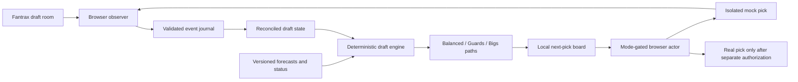

> October27 implementation update: local browser mock, adaptive engine, observer/journal/guards and explicit pre-draft Coach now exist. See [runbook](copilot-runbook.md) and [actual validation](../../artifacts/basketball/2026-10-27/copilot-build/validation/report.md). The external browser bridge was not proven; integration is deliberately restricted to local simulation and explicit real preflight. Live Fantrax observation/writes and the ten-minute gate remain unpassed. Earlier plan-only statements below describe the pre-build state.

# Live browser draft copilot: execution and validation plan

Prepared October 27, 2026 for jxstovik, Fantrax league `mmioj1mvmvgsc3io`. The draft room currently says **October 28, 9 PM EDT**, with eight teams, jxstovik sixth and 14 snake rounds. Balanced remains the selected policy. This document plans a new browser observer, adaptive draft engine and mock-only pick actor. They are not implemented by the existing static advisor.

## Recommendation

Build a local copilot that maintains one reconciled draft state and recomputes three draft paths after every observed pick: **Balanced, Guards and Bigs**. It automatically updates the local recommendation board, while keeping a visible reason for changes. Test browser-driven selections in an isolated mock before enabling any real pick submission. Use the actual Fantrax queue only after its behavior has been verified and the intended update policy authorized.

The first useful version should run in the foreground on the user's desktop, with Fantrax and the local copilot side by side. A daily heartbeat is not a draft runner. Keep deterministic calculations on the response path; generate narrative explanations asynchronously so a model response cannot hold up a pick.

## What was actually checked today

Read-only inspection of the [actual draft room](https://www.fantrax.com/fantasy/league/mmioj1mvmvgsc3io/draft) showed:

- A Starting banner, scheduled time, all eight team headings and 112 empty snake cells. This is pre-draft, not an active turn or completed-pick feed.
- Players, Queue, Roster and Chat tabs. The queue was empty. Available rows have abbreviated player names, school abbreviations and eligibility. The green add action is disabled before the draft; the queue action is present. No action button was used.
- An abbreviated Tanner row opens a full Tyler Tanner/Vanderbilt profile. The inspected row markup did not establish a stable player ID. Do not identify a pick by initials alone, row number, sort rank or DOM order.
- Native accessibility and DOM semantics differ: a player appeared as a link in the native tree but as a generic element in the DOM snapshot. The adapter must be based on measured DOM/accessible behavior, with strict row-scoped selectors and explicit unique matches.

The [NCAAB mock lobby](https://www.fantrax.com/game/mock-draft/ncaab) currently says no draft games are available. This is a time-bound observation, not proof Fantrax never offers them. The general [NBA mock lobby](https://www.fantrax.com/game/mock-draft/nba) exists, but an NBA mock cannot validate this league's college-player forecasts or roster rules. No mock was joined or pick submitted.

Existing local evidence: 26 compiled basketball tests and a scripted 112-pick replay passed in the latest saved validation. That replay did not use a browser and made zero platform calls. It does not establish UI latency, live ingestion, queue safety or successful Fantrax picks. See [evidence/status matrix](../../artifacts/basketball/2026-10-27/live-copilot-plan/validation-matrix.json).

## Architecture and scope

Keep this in `src/basketball/`. Reuse the existing basketball forecast manifest, category arithmetic and dual-eligibility slot matcher. The football draft harness illustrates local state/WebSocket/dashboard plumbing, but its valuation, survival probabilities, position types, ESPN client and data store must not be inherited. It is not already a basketball copilot.

Proposed implementation units:

| Component | Responsibility | Output |
|---|---|---|
| `draft-observer.ts` | Parse permitted browser observations; validate league, team order, phase, pick ownership, identity and displayed clock | Scoped observation with acquisition/receipt times and completeness |
| `draft-journal.ts` | Append observations, selections and explicit corrections; single-writer lease; restart/replay | Immutable journal and atomic current state |
| `draft-adaptive.ts` | Build legal rosters, evaluate marginal category contribution and compare remaining draft paths | Versioned recommendations for all three profiles |
| `draft-trends.ts` | Describe opponents' observed selections, category exposure, positions and remaining demand | Counts, tier depletion and scenario pressure; no inferred private queues |
| `draft-browser-actor.ts` | Verify candidate/turn/slot, perform scoped mock action and reconcile receipt | One action intent and acknowledged result or unknown state |
| Local basketball server/dashboard | Display state, source age, top candidates, path differences, queue preview, pause/control mode | Fast push updates plus a durable local report |
| Local browser simulator | Exact eight-team/14-round college rules, scripted opponents, visible pick controls and injected failures | Reproducible browser test venue |

These names are proposed files, not existing commands. Keep local endpoints bound to loopback, separate basketball data from football, and retain the actual browser tab/league identity at every action boundary.

### First feasibility gate: the browser-to-engine loop

Current browser access is through the provided computer/browser tools. A standalone low-latency event bridge has not been verified. The first implementation task is a hard stop/go spike: measure repeated real browser read → deterministic engine → visible update loops through the exact supported integration, including tool and orchestration overhead. Use a minimal prototype, at least100 successful observations with changing mock state, and a sustained10-minute foreground run including burst/throttle cases. Do not build out the full observer/dashboard/actor on an assumed bridge; stop or revise the integration if it fails. A fast Node calculation alone does not pass this gate.

Use the existing supported browser-control surface initially. Do not attach an undocumented CDP client, extract cookies, inspect hidden application state or bypass HTTP403. Prefer documented browser-visible response data if a permitted interface is established; otherwise parse rendered DOM/accessibility state. If this tool-driven loop cannot meet the timing budget, keep it as a foreground advisory mode and evaluate a separately reviewed browser extension/host integration. Such an integration is a new deployment step, not an assumed capability. No extension or account is installed by this plan.

## Maintaining a correct live board

Each observation should include league/team/session identity, board and rules revisions, phase, observed order, all resolved selections, current picker, displayed clock, observation time, receipt time and coverage. Each pick event binds overall pick, round, owner team, stable canonical player ID, source evidence and sequence/revision.

1. Read the complete selected-pick history, not only the currently visible available-player rows. Virtualized/off-screen cells, tabs and pagination must be tested. If complete history is unavailable, report that limitation and withhold live action readiness.
2. Resolve player identities against the official Fantrax export. Prefer an actually exposed stable ID; otherwise require a unique name-plus-school crosswalk confirmed through full player details. Ambiguity is an unresolved pick, not a fuzzy match. Opening 112 profiles on the clock is not an acceptable steady-state design; establish mappings during preflight.
3. Diff snapshots against the last good state. Repeated snapshots do not duplicate events. A skipped pick, conflicting owner, changed old pick, unknown identity or unexpected reset triggers reconciliation. Empty/failed reads cannot erase the prior board.
4. For commissioner undo/correction, append an explicit correction and rebuild state from the authoritative history. Invalidate recommendations and pending action intents tied to the superseded revision. Never silently edit a historical event.
5. Reconcile own roster and the global board when supported. Derive turn from confirmed order plus actual selections and displayed phase/clock. The old API `running` shells and a local assumed order cannot establish that it is our turn.
6. Detect human picks and queue edits. Treat confirmed human selections as authoritative; pause conflicting pending actions. Polling is single-flight, with bounded retries/backoff and a visible last-good receipt age.

Browser acquisition may be slower than desired. Cache completed-pick identities and forecasts, read only the changed board/clock after bootstrap, and perform full reconciliation periodically or on an inconsistency. Never label cached observations as newly acquired.

## Adaptive draft value

The current `recommendDraft()` removes selected players and enforces slot feasibility, but otherwise sorts a largely static priority list. Add the following before calling the new system adaptive.

### Same inputs, three competing paths

After every pick, evaluate Balanced, Guards and Bigs against the same available players, forecast revision, status flags, eligibility and opponent scenarios. Guards emphasizes the tradeoffs around AST/3PTM/FT%; Bigs explores REB/BLK/FG%; Balanced retains all eight. ST and PTS remain in every comparison. Bigs describes a statistical profile: Fantrax combines forwards and centers into F/C, so drafting many wings is not automatically a center-heavy strategy.

For each candidate, evaluate the best legal ten active players and four reserves after plausible roster completion. Recompute FG% and FT% from summed makes/attempts. Do not add percentages or count all 14 players as simultaneously active. Until schedules/activation rules are reconciled, use an explicitly equal-game, conditional-on-playing draft comparison, not a forecast of legal weekly starts or season totals.

Compare each completed path on the **same eight-category evaluation**, with a category-by-category table, percentage volumes, roster flexibility, omitted-player coverage and minutes stress cases. Profile preferences generate alternative constructions; they cannot make a path look superior simply by scoring it on its own preferred categories. Version any utility/cap/weight choices before evaluation. No category-win probability or historical performance claim is available yet.

### Opponent trends and opportunity cost

Track every team's known roster, remaining G/F-C/Flx capacity, count of recent guard/big selections and observed category exposure. Show concrete descriptions such as a run of guards over the last six picks only when it actually happened. Missing forecast fields make opponent category exposure partial.

A run can increase the cost of waiting, but can also leave strong players elsewhere. For our upcoming two snake selections, compare candidate-plus-next-pick alternatives using a small, bounded search over remaining tiers and legal completions. First use clearly labeled deterministic opponent scenarios: ADP preference, guard demand and big demand, with unavailable players skipped. ADP is a market reference, not a calibrated probability a player survives. Do not report invented survival percentages.

The display should explain: **who moved up, which actual picks caused it, the next meaningful replacement drop, what happens if we wait, and which categories/slots we sacrifice**. Show disagreements across scenarios instead of hiding them in one score. Do not chase a position run mechanically.

### Pivot behavior

Start Balanced. Keep all three paths visible, with a suggested path that may change as evidence changes. A suggestion does not silently change the user's saved persistent strategy. A user-selected temporary path can steer the next decision; permanent punts require an explicit choice. Use versioned tie-breaking/debounce rules to avoid oscillation, and show when differences are too small or input-sensitive to favor a pivot.

Model unknowns remain visible. The current board has 2,209 forecasts from 5,687 identities and 29 selected provider supplements. Only a subset has current-role evidence. A mock can exercise candidates with clearly synthetic review clearance; that clearance must never enter the real league data. Before any real automatic selection, curate the plausible candidate set, resolve high-priority omissions/disagreements and require appropriate status/eligibility review.

## Browser action modes

| Mode | Reads/recommendations | Queue/pick behavior |
|---|---|---|
| Observe | Reconcile state | No Fantrax changes |
| Coach — initial real-league mode | Adapt the local board and preview queue/picks | User makes picks; no Fantrax mutation |
| Mock auto | Observer and adaptive engine against a verified isolated test session | Automatically queue/select mock players and verify receipts |
| Live queue editor — disabled by default | Preview exact queue changes and affected autopick order | Requires separate queue-write scope; preserve user pins, verify readback, pause on user interference/clock races |
| Live rank-list import — outside the response loop, disabled | Review complete CSV and replacement effect | Requires separate rank-import scope and full readback |
| Live confirmed pick — disabled by default | Bind a single candidate/slot/turn to fresh state | User approval of the exact pick; one click sequence, verified receipt and expiry |
| Live automatic picks — disabled by default | Only after venue-specific tests and separately authorized execution policy | Candidate/turn/risk limits and receipts enforced; no inherited football `--auto` |

All real queue/rank/pick writers remain disabled for the current October28 deployment posture. This plan grants no execution scope. A capability can be reconsidered only after its own gates and separate user authorization are satisfied; success in one write mode does not enable another.

The user's current request authorizes planning and mock validation work. It does not instruct this turn to submit a real league pick or overwrite a live queue. A local board update is separate from a Fantrax queue edit. Updating a queue can change a later autopick, so it is a separate mutation with its own deadline/readback and fallback tests. Present any proposed live queue ordering and its effect before enabling that writer.

Actor sequence: bind intent to session/league/team, current overall pick, player, slot, state hash and expiry → reread phase/turn/clock/availability → uniquely locate player → select legal destination → verify confirmation text → click once → independently observe the same player's selection at the same overall pick/owner. A button click or disappearance from the available list alone is insufficient. If the result is unknown, reconcile before doing anything else; no blind retry. Local intent keys do not make Fantrax clicks idempotent.

Confirm fill-active-first behavior, queue versus position/ranking precedence, reserve placement and autopick interactions in the actual test room. The previously inspected help describes rankings and queue precedence, but not a successfully tested write path in this league. Keep a reviewed native queue/manual access as fallback, with one writer controlling updates.

## Latency budget — proposed acceptance targets

These are engineering targets to measure, **not observed Fantrax performance**. The real league has a one-minute clock.

| Measurement | Initial target | Evidence required |
|---|---|---|
| Browser-visible pick → observer receipt | p95 ≤3 seconds | Timestamped acquisition trace, including polling/tool delay |
| Validated state → adaptive result | p95 ≤500 ms | Deterministic local timing at full candidate size |
| Browser-visible pick → local board rendered | p95 ≤5 seconds | End-to-end trace including dashboard paint, not just server broadcast |
| Allowed mock action dispatch → authoritative UI receipt | p95 ≤10 seconds | Actual browser clicks plus board/owner confirmation |
| Safety/correctness | Zero wrong player/team/turn or duplicate committed picks | Reconciled journal and independent final board comparison |

Use a monotonic clock for local intervals and preserve UTC wall times for audit. Include model/tool scheduling delays in user-visible timing. Report sample size, median, p95 and maximum; never present a single best-case run as a percentile. In the simulator, source commit time is known. On Fantrax, server commit time may be unavailable: bracket detection using last successful read/first visible observation and label that measurement honestly.

Start with a target 1–2 second supported observation cadence near our turn, measured against actual site/tool limits, single-flight and without reload loops. This cadence is not established today. Precompute/cache off-turn. Before a pick, require a just-read state (initial target ≤5 seconds), valid displayed clock and no reconciliation error. If observation age exceeds10 seconds, pause writes. Stop initiating browser picks below a proposed15-second clock buffer and use manual/reviewed native fallback. Rehearsal results must determine whether these thresholds are adequate; failing the budget leaves the system in Coach mode.

## Validation ladder

### 1. Deterministic engine and parser tests

Build before compiled tests. Add tests for idempotent repeated observations, missing/double/reordered picks, commissioner undo, manual selection, wrong league/team, phase shells, ambiguous initials, unknown IDs, incomplete virtualized history and stale/failed reads. Verify eight-category arithmetic, weighted percentages, dual eligibility, active/reserve placement, known-status blocks and no turnover penalty.

Adaptivity tests must change the roster/opponent selections while holding forecasts fixed and show explainable recommendation changes. Guard runs must not force a guard recommendation in every case. Test weak frontcourt depth, excess overlapping guards, FT damage from bigs, uncertain freshmen, short histories and three-path comparisons under shared inputs. Identical input/revision/seed must reproduce identical output. Strategy stress tests establish behavior, not winning accuracy.

### 2. Local browser mock with exact league rules

Build a clearly labeled PMT synthetic draft page, not a counterfeit Fantrax page. It should have the visible controls the browser actor needs: available list, queue, legal slot chooser, confirmation, clock, team rosters and 112-pick board. Use real versioned forecast inputs if desired, but synthetic selections/opponents and separate data directories. The browser must actually drive controls; a direct POST to a test endpoint is not a browser-action pass.

Run at least three seeded full112-pick drafts, giving42 own browser selections, with normal60-second own clocks and accelerated opponents. Include balanced, guard-demand and big-demand opponent scenarios. Reconcile every final selection/owner to the simulator's authoritative log and all14 own players to legal slots. Save before/after screenshots, DOM observations, action receipts and timing traces. Prove player removal and profile re-ranking become visible after actual browser picks.

Inject disconnects, hidden/virtualized rows, stale clocks, missing pick batches, duplicate snapshots, a player taken between recommendation and confirmation, human interference, commission undo, changed labels, browser focus loss, slow engine, failed acknowledgement and process restart. The pass is correct recovery or a safe pause—not merely finishing the draft. Resume without duplicate actions or silently fabricating missed picks.

### 3. Real Fantrax browser rehearsal

Recheck the NCAAB mock lobby. If a free college mock appears, verify that it is a practice venue with no purchase/account/terms change, then use it for the browser loop. Record its actual teams, slots, scoring and clock; do not assume they match Banging 3s. Differences belong in a separate transport-test configuration.

If no college mock is available, a free NBA mock may test login/session handling, selection UI, queue ordering, confirmation and receipts with NBA test identities. It cannot validate college strategy or the CBB ID crosswalk. A private free practice league is another option only if the user chooses that setup; no paid contest or new account is part of this plan. If there is no suitable real test venue, report the production writer as unvalidated and retain Coach mode.

### 4. Actual-league preflight and shadow mode

On draft day refresh the relevant pool/status data, verify order/clock/identity/slot behavior, resolve Position overrides and compare the observer to the visible board. During actual selections, initially observe and suggest while the user picks. Require reconciliation with the actual picks and measured live timing before expanding capability. Never use tomorrow's real picks as a mock writing test. The user's native/manual fallback must remain usable throughout.

## Delivery order and go/no-go

1. **Observer and loop feasibility:** capture redacted DOM fixtures from permitted views, prove stable crosswalk and complete pick reads, measure supported browser-to-engine roundtrip. Deliver observation/reconciliation report. This is the next implementation step.
2. **Adaptive engine and local board:** three paths, legal-completion search, opponent-demand summaries and explainable marginal values. Deliver deterministic scenario comparisons with provenance and missing-data flags.
3. **Mock browser actor and failure harness:** three complete browser-driven synthetic drafts, race/restart tests and latency report. All action endpoints default to isolated mock mode.
4. **Real Fantrax practice transport:** verify actual queue/pick/receipt behavior in a suitable free room. If unavailable or too slow, explicitly withhold real automatic submission.
5. **Draft-night deployment:** foreground observer/Coach mode, reviewed native/manual fallback. Enable any broader real action mode only after evidence and the separately authorized scope support it.

Critical [Luna xhigh review](committee/11-live-copilot-plan-review.md) withheld current live readiness. Its link, bridge-gate and action-mode findings have been incorporated; the forecast coverage and real-room validation gaps remain.

Initial session launch should show the exact league/team, source ages, mode, last observed pick and clock, board/model revision, user-selected strategy, suggested strategy and unresolved gates. Pause must be immediate and persistent. A second process cannot acquire a writer lease. After a restart, reconcile the authoritative board before allowing a new action.

Timing: draft is tomorrow at9PM EDT. Prioritize1–3 immediately. Suggested draft-day preflight is8:00PM, fallback/order verification8:30PM, room ready8:45PM. These are proposed checkpoints, not new scheduled jobs or promises that an automatic writer will be ready. The existing daily automation may continue independent bounded work by reading this plan; it is not the latency-sensitive runner.

Deliverable evidence should include source/DOM fixtures and hashes, engine tests, three complete mock journals, failure outcomes, measured latency percentiles, actual Fantrax rehearsal receipts if available, and an explicit per-mode go/no-go report. The broader forecast model remains experimental regardless of browser test success.
