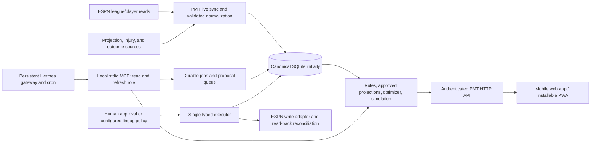

> Historical architecture review at commit `93fa36c`. The statements below about
> no code changes, 243 baseline tests and Node 24 describe the initial review.
> See [implemented rebuild status and rollout](rebuild-status.md) for the new
> Node 26 runtime, delivered changes, verification and remaining live gates.

# Pardon My Trade: reliability, autonomous operation, and portable app plan

Review date: October 1, 2026. Repository: https://github.com/jxstovik/Pardon_My_Trade. Reviewed commit: `93fa36c49a32ac293e37955aba0f304ac9178395`.

Architecture review: GPT-6.1 Sol. Working reviews: GPT-6 Luna for ESPN integration and runtime/Hermes/web readiness. This is a review and implementation plan; no application code was changed and no deployment or fantasy transactions were performed.

## Recommendation

Keep the existing TypeScript ports-and-adapters core, rule engine, Hermes MCP integration, and model-governance machinery. Consolidate their data and execution paths before expanding capabilities. Deploy one persistent backend/Hermes host first, and expose an authenticated mobile web app that reads the same authoritative state. Add optional independent frontend hosting after that works.

The main problem is that individually implemented pieces do not yet form one dependable live-league workflow. Fix data correctness and state consistency before granting the agent additional execution authority.

## What was verified

- Cloned the default branch and reviewed code, AGENTS.md, tests, deployment documentation, and existing Hermes integration.
- `npm ci`, `npm rebuild better-sqlite3`, and `npm test` completed. All 243 tests passed, including the compiled TypeScript build.
- The review environment ran Node `24.19.0`. The repository requests Node 26 in `.nvmrc` and Hermes docs, while package.json accepts Node >=20. A release needs one agreed runtime and validation on that runtime.
- An unauthenticated GET to the exact public projection endpoint constructed by the source for season 2026/week 4 returned HTTP 404:
  `https://site.web.api.espn.com/apis/site/v3/sports/football/nfl/projections?seasontype=1&season=2026&week=4`.
- No ESPN private-league credentials were configured. Private-league access, cookie validity, and write payload compatibility remain unverified. The 404 establishes failure of the tested projection URL, not failure of every ESPN endpoint.

## Priority findings

File references are relative to the reviewed repository. Lines refer to the reviewed commit.

| Priority | Evidence | Consequence | Planned correction |
|---|---|---|---|
| P0 | `src/projections/espn-projection-source.ts:53–60`; tested URL returned 404; registry defaults to ESPN | Default live projections fail even though fixture tests pass | Replace with a validated fantasy league/player-stat read path, schema validation, coverage reporting, and explicit degraded status |
| P0 | `src/cli.ts:308–322`, `735–748`; `src/pipeline/refresh.ts:34–44` | GUI refresh and a scheduler dependency use the demo fixture after a live import | One platform-aware sync/refresh service; demo mode explicit; league/team identity enforced through every entrypoint |
| P0 | `src/agents/snapshot-integration.ts:133–138`, `169–175` | Bench players become BN candidates and cannot move into starting positions; FLEX loses natural eligibility | Separate current slot from player position/eligible slots; optimize against actual eligibility and lock constraints |
| P0 before remote access | `src/api/server.ts:52` onward; `src/cli.ts:333` | API has no authentication, and server does not explicitly bind to loopback | Authentication, league authorization, protected mutations, TLS proxy, private binding |
| P0 before shared deployment | `src/mcp/server.ts:79–82` versus `src/cli.ts:281–282` | MCP and GUI use different V1 database files; agent-produced alerts/news may be invisible in the app | One configuration factory and canonical database with versioned migrations |
| P1 | `src/api/server.ts:41–64`; `src/season-refresh.ts:44–47` | GUI holds a process-local snapshot; projection refresh does not re-sync roster/availability | Immutable live snapshots, transactional latest-snapshot pointer, fresh database reads or version-aware cache |
| P1 | `src/seasons/season-orchestration.ts:58–61`; `src/mcp/server.ts:333–345` | Recommendations rebuild models with no observations instead of using persisted learned models | One approved runtime projection/model resolver used by API, MCP, CLI, and optimizer |
| P1 | `src/agents/action-queue.ts:73–108`; `src/agents/action-executor.ts:100` onward | Independent MCP processes cache/rewrite JSON state, risking stale approvals, lost actions, and duplicate execution | Transactional action, job, receipt, and audit tables; atomic leases and compare-and-swap transitions; single executor |
| P1 | `src/mcp/stdio.ts:8`; `src/mcp/server.ts:68–94`, `120–128`; Hermes config uses tool filtering | Both MCP instances can register the same operator tools; all tools claim idempotency | Server-enforced roles, separately constructed writer dependencies, operation idempotency, accurate tool annotations |
| P1 | `src/adapters/espn/espn-platform-reader.ts:305–342`, `375–390`, `508–518` | Scoring parser expects simplified top-level fields, schedule period uses league ID, roster locks are always false | Validate real ESPN schema, league scoring rules, schedule semantics, eligible slots, and kickoff/transaction locks |
| P1 | `src/scheduler/scheduler.ts:32–95` | Exact-minute, in-memory scheduling can miss runs or overlap; run state is not durable | One scheduler owner plus durable jobs, leases, retries, and catch-up policy |
| P2 | `public/index.html`, `public/modeling.html`, `src/api/server.ts` | Existing GUI/replay page does not answer current roster, lineup distribution, or free-agent impact questions | Add roster-facing projection and scenario services and mobile app views |

Other important corrections: explicit team configuration must replace fallback to the first team; `import-espn <leagueId>` should not require a redundant environment league ID; ESPN client request recordings must redact cookies; bound request timeouts and retry only safe reads; use source-native player IDs before conservative name matching; report unmatched/ambiguous records and unsupported scoring rules. ESPN reader currently caches league data indefinitely on an instance, so execution revalidation needs a forced fresh read or a new uncached client.

The scoring-settings response-shape mismatch remains a live-schema hypothesis to check against a sanitized response. The player `defaultPositionId` map at `espn-platform-reader.ts:104–111` also maps 6 to DST and omits 16; this conflicts with the expected ESPN D/ST convention and needs a captured-payload regression test before being called live-verified. Keep player-position IDs separate from lineup-slot IDs.

## Target architecture

All entrypoints call shared application services rather than implementing their own refresh/model-selection behavior. Keep decision rules in code. Hermes schedules, requests analysis, explains evidence, and proposes actions through typed tools. PMT controls eligibility, scoring, data freshness, action permissions, and submission outcomes.

### Authoritative state

Use the current SQLite dependency for the initial single-host deployment. Consolidate knowledge and V1 tables, and migrate JSON queues/receipts/runtime metadata into SQL. Enable WAL and busy timeouts; use short transactions, foreign keys, and unique constraints. Put model binaries/research artifacts in versioned files or object storage, with hashes and metadata in the database.

Suggested tables: `league_connections`, `league_snapshots`, `latest_snapshots`, `player_identities`, `projection_runs`, `player_projections`, `completed_outcomes`, `model_versions`, `active_models`, `job_runs`, `actions`, `action_receipts`, and `audit_events`. Scope records by platform/league/season/team/period as appropriate. Preserve immutable snapshots; advance the latest pointer only after successful validation. Never overwrite a valid live snapshot with fixture data or an empty partial response.

Identify each proposed operation by league, team, period, canonical payload, and intent. Retry a job without creating a new proposal. Claim execution atomically and record submission intent before network I/O. If ESPN may have accepted a request before a timeout/crash, mark the result unknown and reconcile live state/history before any retry. Local idempotency cannot guarantee exactly-once execution on ESPN.

### ESPN diagnosis and repair

Add `pmt doctor --platform espn --read-only`, producing redacted JSON and a readable summary:

1. Validate league, season, team, and credential presence; public reads need no cookies when supported. Do not print ESPN_S2 or SWID.
2. Read league metadata and verify the returned league/season and selected team. Distinguish forbidden/private/auth failures from not found, rate limiting, HTML/non-JSON responses, and schema changes.
3. Compare starters, bench, IR, roster counts, eligible positions, settings, schedule, and scoring period with the ESPN interface.
4. Fetch roster projections and paginated free-agent/player-pool data through a tested fantasy read endpoint. Validate season, scoringPeriodId, statSourceId/statSplitTypeId semantics and numeric stat IDs using captured real responses.
5. Extract league-applied point projections or compute points from projected statistics using actual league scoring. Record unsupported custom bonuses, kicker/DST rules, and scoring assumptions explicitly.
6. Report projection coverage separately for starters, bench, and relevant free agents; expose missing values as unknown, not zero.
7. Save a sanitized real response fixture and contract checks. Keep live checks opt-in and credential-free tests deterministic.

Do not guess a replacement write URL/body from mocked tests. Validate read/write segment differences and endpoint-specific payloads against real current request evidence. Initial live operation remains read-only; write canaries happen only after correctness and executor gates pass.

## Phased implementation and acceptance gates

Rough planning budget: 6–8 weeks for one experienced implementer with scoped parallel support. This is an estimate, not a completion promise; each phase advances on evidence. Reliable read-only operation and the first mobile app should arrive before full action automation.

| Phase | Work | Acceptance gate |
|---|---|---|
| 0: Baseline and live diagnosis | Pin runtime/toolchain; establish doctor command; explicit live/demo and league/team config; capture sanitized read contracts; inventory existing services | Clean CI on chosen runtime; doctor accurately reports source failure; selected live league/team is never replaced by demo data |
| 1: ESPN and lineup correctness | Repair projections; parse actual scoring/schedule/eligibility; handle SUPER_FLEX and unsupported slots explicitly; fresh roster/free-agent sync; kickoff/lock constraints | Roster/settings match ESPN; all starters have valid current-period projections or a visible blocker; bench/FLEX/lock regression tests pass |
| 2: Shared reliable core | Canonical database/config; queue/receipt migration; latest pointer; fresh API reads; durable jobs and shared service layer; server-side MCP roles | Separate API/read/operator processes see identical state; concurrent execution submits once locally; stale approval blocked; restart/timeout recovery demonstrated |
| 3: Persistent agent deployment | Deploy backend/Hermes with persistent volume and TLS; pin versions; Hermes owns scheduling; health/backup/alerting; shadow recommendations | Restart/restore drill passes; no duplicate schedules; missed jobs catch up correctly; approximately two scoring cycles of audited read-only/shadow operation |
| 4: Projection and scenario service plus portable app | Canonical approved distributions; lineup optimization and simulation; current roster, lineup, and free-agent pages; authenticated PWA | Mobile app reflects agent updates without restart; scenario preserves baseline and reoptimizes legally; coherent distributions and provenance visible |
| 5: Controlled team management | Unified executor for all paths including `ff-run --auto`; forced fresh revalidation; write-contract canary; lineup policy with limits/kill switch | Human-approved lineup canary matches ESPN read-back; unknown outcomes halt retries; stale/locked/wrong-team actions blocked |
| 6: Model and operating improvements | Completed-outcome ingestion; rolling evaluation/promotion; correlated scenarios; broader sources/features; optional separate frontend/Postgres | Promoted model meets predefined causal holdout/calibration gates and rollback works; operational objectives met across several cycles |

Phases 3 and 4 are the two requested deployment frames: autonomous persistent runtime and portable web interface. Phase 5 increases action autonomy after both can be observed and trusted.

## Projection and roster scenario design

Unify `src/probabilistic` and `src/projections` behind a single versioned weekly distribution contract. Preserve provenance and calibration evidence. Recommendations must consume the active approved model version, not silently rebuild empty-observation priors.

Each projection should carry canonical player identity, league scoring hash, season/period, as-of timestamp, model/source version, availability assumptions, sample or distribution representation, mean, spread, and quantiles. Separate weekly, per-game, season-total, and rest-of-season units explicitly. A research replay/preseason artifact is usable only when its player IDs, target period, scoring system, cutoff, and approval match runtime needs.

Initial baseline: league-scored source means plus empirically calibrated residual distributions by position, availability, and role where data permits. Mark cold-start uncertainty as an estimate. Rework the existing fallback path: it always constructs a historical candidate even with no usable observations, so the priority rule prevents external fallback selection and loses rich provenance. Also make negative fantasy points and inactive-player mass consistent; clipping normal quantiles to zero while using untruncated normal probabilities elsewhere is incoherent.

Lineup totals should be generated from joint samples. At minimum, publish the independence assumption. Then add empirically estimated team/game factors for QB/receiver correlation and other material dependencies; regularize sparse covariance estimates. Compute total mean and percentiles from total samples rather than adding player percentiles. Include actual points plus remaining-game distributions once games start.

For a free-agent scenario:

1. Freeze snapshot, scoring period, active model version, and simulation seed.
2. Validate availability/waiver status, eligibility, roster limits, IR rules, and potential drop restrictions.
3. Add the candidate and optionally drop the selected player in a hypothetical roster.
4. Re-optimize unlocked starters with the same objective and constraints used for the baseline.
5. Evaluate baseline and proposed lineups using paired joint samples; shared players must retain the same simulated outcomes.
6. Return changed starters, expected starting-lineup gain, distribution of the gain, probability of improvement, downside/upside changes, and matchup win-probability change when opponent data is adequate.

A candidate outperforming a bench player does not necessarily improve the starting lineup. Show depth/bye coverage and rest-of-season value separately from this week's scoring gain. Counterfactuals never submit moves.

Evaluate models through time-ordered walk-forward tests with feature cutoffs. Track MAE/RMSE, interval coverage, proper probabilistic scores such as CRPS, subgroup coverage, player-match rate, and projection freshness/coverage. Compare with current ESPN/source means and the existing simple baseline. Predefine promotion thresholds and minimum samples; avoid inventing confidence from the number of sources. Automate training/evaluation, and promote only when the governance gate passes.

## Portable app scope

Build on the existing HTTP service and UI for the first release; a full framework rewrite is unnecessary. Add a responsive, installable PWA with these views:

- **My team:** selected league/team/week, ESPN-confirmed starters, bench, IR, injury/bye/lock state, current versus recommended lineup, last successful sync, and stale-data banner.
- **Player projections:** mean/median, P10/P90 or selected interval, histogram/CDF, threshold probabilities, sources, model version, and availability assumptions.
- **Starting lineup:** aggregate distribution, expected total, downside/upside, actual plus remaining points, and opponent comparison when supported.
- **Free agents:** filter by position/status, compare add/drop choices, show optimized lineup gain and uncertainty, and overlay baseline/proposed totals.
- **Agent activity:** run status, rationale/evidence, queue, approvals, submission receipts, source health, paused execution, and model promotion/rollback history.

Suggested endpoints: `GET /api/me`, `GET /api/leagues/:leagueId/teams/:teamId/roster`, `GET /api/.../projections?period=...`, `POST /api/.../lineup-simulations`, `POST /api/.../free-agent-scenarios`, `GET /api/.../agent-status`, and authenticated action preview/approve/reject endpoints. Return snapshot/model versions and timestamps on every analytical response. Poll or use server-sent events for updates.

Use secure session cookies, league-scoped authorization, CSRF protection for cookie-authenticated mutations, request validation, and rate limits. Keep ESPN cookies on the backend. Public health reveals minimal metadata; readiness/diagnostics require authentication. Cache static PWA assets; avoid shared caching of private API responses. Offline views should prominently identify last-known data and cannot approve/execute actions.

## Deployment frames

### A. Autonomous host

Default: one persistent Linux VPS with Docker Compose or systemd. Start with roughly 2 vCPU/4 GB for the app and hosted-model Hermes; benchmark before reserving larger machines for Python training or local LLMs. Services: PMT API/application, Hermes gateway, and TLS reverse proxy. Run CPU-heavy training as a resource-limited job or separate worker later.

- Pin source commit, Node runtime, lockfile, Hermes version, provider/model IDs, and artifact hashes. Fill the existing compatibility manifest's unpinned Hermes fields in a release record.
- Mount one durable data directory. Use SQLite-aware online backups plus versioned artifact backups; test restoration. Never place SQLite on a network share or duplicate it across hosts.
- Have Hermes cron own the outer schedule. Disable PMT daemon/serve scheduler. Every wake calls durable idempotent PMT job services; cron alone is not a correctness guarantee.
- Keep one executor worker; isolate read/refresh MCP capabilities from operator capabilities server-side. Default execution disabled, then gradually enable lineup policy.
- Persist heartbeats, job history, source status, freshness/coverage, action receipts, unknown outcomes, model versions, and redacted structured logs. Display them in the app.
- Use game/league deadlines to schedule pre-lock refreshes and injury checks, with explicit timezone and bounded catch-up. Fixed Sunday reminders do not cover Thursday/Monday games.
- Initial operating targets: >=99% scheduled refresh completion within its allowed window, all selected starters either covered or explicitly blocked, and zero unexplained duplicate submissions. Alert on credential failures, stale roster/projections, missed pre-lock checks, and unknown execution results.

### B. Portable web app

Serve the authenticated PWA and API from the same host/domain first. This keeps state, authentication, and deployment simple and works across phone, tablet, and laptop.

Optionally deploy the frontend independently to Vercel or another static host once the API contract is stable. Keep Hermes and stdio MCP on the persistent host. Route browser requests through an authenticated same-origin backend-for-frontend or narrowly configured API access; never ship ESPN credentials or shared administrator tokens to the browser. This is optional hosting architecture, not a requirement to adopt Next.js.

If multiple backend hosts, high write concurrency, or multi-user scale become necessary, migrate authoritative state to Postgres and model artifacts to object storage. Preserve the same services/contracts. Do not add that operational burden solely to make the first personal app portable.

## Autonomy policy

Autonomous data refresh, news collection, outcome ingestion, evaluation, scenario analysis, and proposal generation can be enabled first. Hermes should be able to recover transient read failures through bounded retries and report actionable blockers.

Existing AGENTS.md and Hermes integration require explicit approval for trades, drops, and waiver claims. Retain that contract in the initial implementation. Approval and execution remain separate, and neither an LLM nor its read-role MCP server may self-approve. For later automatic lineup changes, add an explicit per-league policy: unlocked players only, known scoring/eligibility, fresh data, exact team scope, minimum expected gain, daily action limit, full receipts/read-back, and emergency pause.

Expanding autonomy to acquisitions/trades is a later product/policy decision, with budgets and protected players; it is not implicitly enabled by scheduling an agent. Fail closed for uncertain or stale inputs while retaining the last good view and explaining why execution is paused.

## Work allocation for implementation

Sol 6.1 owns contracts, architecture decisions, dependency order, review of cross-cutting changes, and phase acceptance. Luna 6 workers handle scoped tasks after those contracts are written:

1. ESPN worker: doctor, sanitized contracts, adapter/scoring/player-ID fixes, pagination and lock handling.
2. Reliability worker: shared configuration, SQL migrations, job leases, queue/receipt transactions, and recovery tests.
3. Modeling worker: canonical distributions, persisted-model consumption, outcomes, calibrated simulation, and paired scenarios.
4. Web worker: authenticated roster/projection/scenario UI, mobile behavior, freshness and agent activity views.
5. Operations worker: reproducible host packaging, secrets wiring, health/backup/restore scripts, version manifests and release runbook.

Workers should avoid overlapping migrations/contracts. Every pull request states the trigger and corrected behavior, includes targeted regression evidence, and identifies changes to platform permissions. Existing 243 tests remain the baseline, supplemented with realistic adapter contracts, cross-process queue tests, missed-job recovery, model cutoff checks, and full browser-to-live-snapshot scenarios. Never treat a mocked successful POST as proof of a working ESPN write.

## First implementation slice

The first reviewable change should deliver a redacted ESPN doctor command, explicit live/demo and league/team configuration, a corrected live refresh path, player eligibility regression fixes, and a starter-projection coverage report. Its demonstration: import the selected ESPN league, refresh it, show the same team/roster in CLI, MCP, and GUI, and visibly identify any missing projections. That creates a reliable base for the host deployment and distribution app.

Actual rollout later needs the user's league/season/team identifiers, backend-only ESPN_S2/SWID for private access, chosen persistent host/domain, Hermes provider/version/model configuration, and desired lineup-execution policy. None are required to start the code fixes. These secrets should be configured through the deployment environment, not pasted into the plan or agent prompts.
